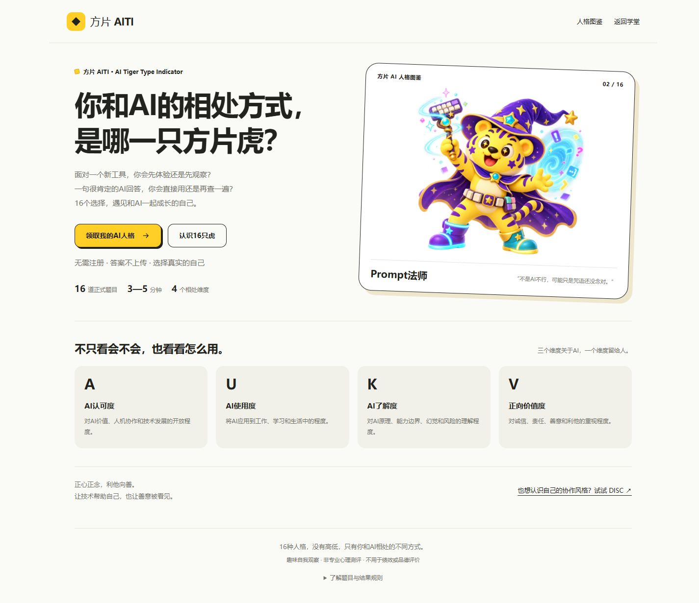
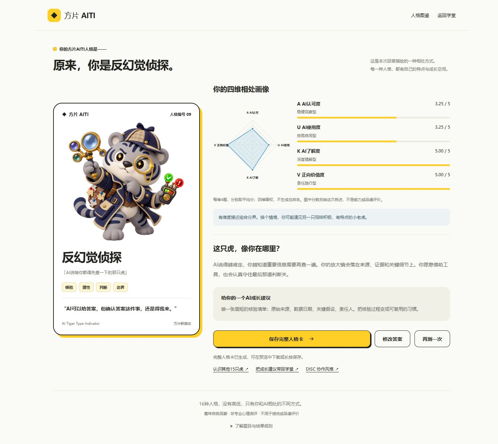

# 方片 AITI 开发与素材记录

本次将原 MBTI 风格模块升级为 AI Tiger Type Indicator，采用用户提供的 16 道正式题目与 16 种方片AI人格。参考 [用户指定项目](https://fangpian-aiti-tigers.jmeng1376.chatgpt.site/) 的角色图片、暖黄配色、插画比例和收藏卡布局，结合现有学堂重新实现。

## 用户确认与图片来源

参考站存在白、灰、黑、粉等不同配色。用户明确选择“直接沿用参考站的16张原图和配色”，因此没有将角色重新染为黄色，也没有生成替代图。

全部 16 张原始 PNG 已下载到 `public/slides/assets/aiti/`，每张 768×768，共约 11.3 MiB。`manifest.json` 记录原始文件名、角色名称、来源地址、尺寸、字节数及 SHA-256。自动化检查验证本地图与记录的原始哈希一致。首屏只加载主视觉，人格图鉴在进入后按需加载图片。

命名、江湖称号、关键词和宣言按用户提供的最终清单；补充的趣味解读与成长建议保持积极表达。界面以暖黄 `#ffcf28`、深色 `#22221f`、浅色 `#fafaf7` 与科技蓝 `#4797c5` 为主；主视觉完整显示角色与道具，使用 contain，避免裁掉帽子、工具或尾巴。

## 功能与入口

- `aiti.html`：AITI 首页、答题、揭晓动画、结果、人格图鉴与保存预览。
- `aiti-data.js`：正式题目、四维定义、16 种人格、组合规则和本机记录清洗。
- `aiti.js`、`aiti.css`：界面、可访问单选、雷达图、弹窗和完整 PNG 导出。
- `disc.html`：原 DISC 协作风格独立入口，保留其原记录。
- `personality.html`：兼容旧链接，按原哈希引导到 AITI 或 DISC。
- 五语言首页的原 JD 卡片位置均进入 AITI；英文/韩文注明报告为中文。

原 32 题 MBTI 答卷不换算为 AITI。AITI 使用独立的 `fangpian_aiti_v1` 本机存储键，不改写旧 `fangpian_personality_v1`，也不影响课程学习进度。

## 16 题与四维计分

题目逐字采用用户本轮给出的正式版本。Q1—Q4 观察 A、Q5—Q8 观察 U、Q9—Q12 观察 K、Q13—Q16 观察 V。统一五级回答：非常不同意、比较不同意、不确定/看情况、比较同意、非常同意，分别计 1—5 分。

| 维度 | 名称 | 权重 | 两种正向倾向 |
| --- | --- | --- | --- |
| A · Acceptance | AI认可度 | 25% | 稳健观察型 / 开放探索型 |
| U · Usage | AI使用度 | 25% | 按需启用型 / 日常实践型 |
| K · Knowledge | AI了解度 | 25% | 持续探索型 / 深度理解型 |
| V · Value | 正向价值度 | 25% | 价值探索型 / 责任践行型 |

每维取对应 4 题的平均数，完整保留 1.00—5.00 连续分数。首版组合分界设为 3.50：达到分界记作内部位 1，其余记作内部位 0，按 A/U/K/V 顺序组合。四维同等参与类型匹配，不生成总分或优劣排名；距离分界不超过 0.25 时提示结果可能随情境变化。

分界和下面的角色分配是首版产品规则，不是经心理学常模验证的结论。参考站采用另一套情境题与维度，本次仅参考其视觉与图片，没有套用那套计分。

| 内部组合 AUKV | 编号 | 人格名称 |
| --- | --- | --- |
| 1111 | 01 | 赛博诸葛 |
| 1110 | 02 | Prompt法师 |
| 1100 | 03 | AI炼金术士 |
| 0111 | 04 | 人机搭子王 |
| 1010 | 05 | 脑洞永动机 |
| 0110 | 06 | 数字鲁班 |
| 1000 | 07 | AI开荒者 |
| 1011 | 08 | 善意放大器 |
| 0011 | 09 | 反幻觉侦探 |
| 0100 | 10 | 效率开挂虎 |
| 1001 | 11 | 灵感捕手 |
| 1101 | 12 | 共创带飞王 |
| 0010 | 13 | AI清醒派 |
| 0001 | 14 | 疯狂进化虎 |
| 0101 | 15 | 靠谱输出机 |
| 0000 | 16 | 长期主义虎 |

内部组合位不在页面作为“高/低”标签显示。所有人格均有名称、江湖称号、原版角色图、四维画像、四个关键词、宣言、趣味解读与成长建议。

## 答题、揭晓与分享

未回答当前题时不能继续；支持上一题修改、刷新续答、从首页重开和结果页编辑。完成后播放约 3.5 秒的五阶段揭晓，可以直接跳过；系统偏好减少动画时直接显示结果。此过程使用本机固定规则，没有伪装外部模型调用。

结果页显示真实连续分数与 SVG 雷达图。保存按钮生成宽 1080 像素、高度随文案调整的完整 PNG，包括所有八项人格内容；手机可长按保存，电脑可直接下载。卡片使用 AITI 标识；ARP 正式入口确定后可再加入二维码。

人格图鉴可查看全部 16 种角色，图鉴介绍明确区别于个人测试结果。没有姓名输入或自动发群、发朋友圈行为。

## 验证记录

模型测试覆盖四维各四题、等权重、16 种组合全覆盖、连续平均分、分界及邻近值、漏答与非法值、存储损坏/不可用、旧答卷隔离、原图哈希、入口兼容。

浏览器使用预设样例作答，非用户或员工的真实测评：A/U 各取 `[3,3,3,4]`，K/V 各取 `[5,5,5,5]`，结果为反幻觉侦探，四维为 3.25、3.25、5.00、5.00。已核对原图显示、刷新续答、揭晓与完整 PNG 下载。

完整测试共 28 项通过，生产构建成功；内容检查覆盖 2,544 个 HTML 页面与 82 个 JS 文件，语法问题、缺失素材引用和旧广告/JD 清理残留均为 0。浏览器在 375、768、1440 像素宽度检查了布局，手机答题与结果页无横向溢出，原生单选支持键盘方向键。已验证旧 MBTI/DISC 入口跳转、独立 24 题 DISC、修改答案与刷新后恢复，检查时控制台无警告或错误。验收样例答卷已从预览浏览器清除，保留全新答题入口。

下载的反幻觉侦探样例 PNG 为 1080×2123 像素，已目视检查人格插画、雷达图、解读、建议与页尾文字完整。验收截图保存在本目录的 `screenshots/aiti-home.jpg`、`screenshots/aiti-result-sample.jpg` 和 `screenshots/aiti-quiz-mobile.jpg`。

源码仍使用现有本地学堂工程，未修改参考站，也未替换其线上版本。ARP 部署、公司账号与结果云端存储属于后续服务接入。

