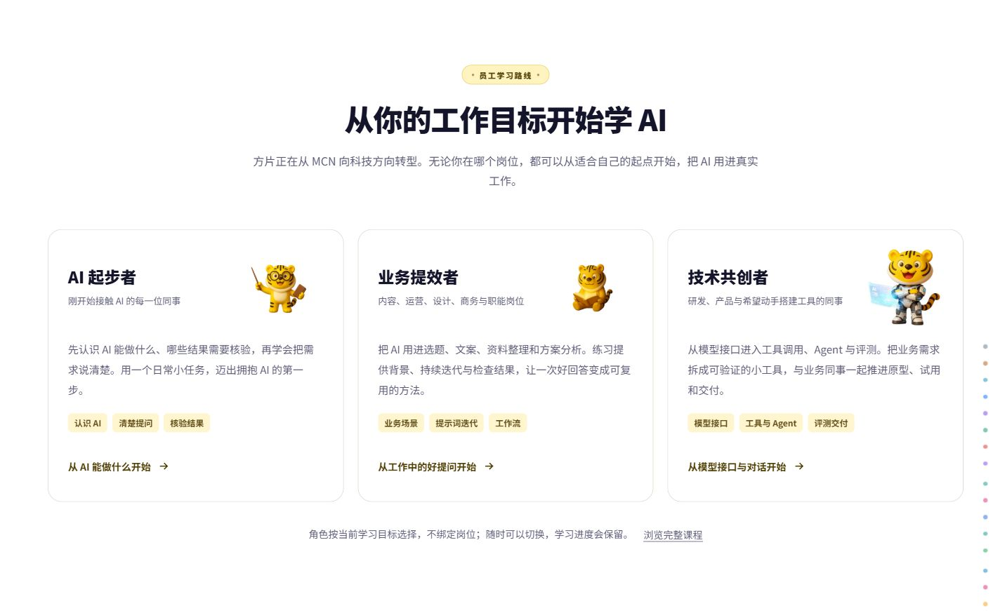

# 内容一致性修正与员工学习路线

本批只实施内容底线、元数据一致性与员工学习入口；AITI/DISC 维持独立。源码来源、必要的技术引用及品牌原图均保留。

## 学习入口

首页原「这门课适合谁」替换为「从你的工作目标开始学 AI」，说明公司从 MCN 向科技方向转型的背景。角色代表当前学习目标，可跨岗位选择，也可随时切换。

| 角色 | 面向同事 | 起点 | 练习目标 |
| --- | --- | --- | --- |
| AI 起步者 | 刚接触 AI 的全体同事 | `zero-0.html` | 完成一个日常任务，并说明哪些结果需要核验 |
| 业务提效者 | 内容、运营、设计、商务与职能岗位 | `ai-tips-context.html` | 整理一项重复工作的输入、提示词、检查点与交付标准 |
| 技术共创者 | 研发、产品与希望搭工具的同事 | `1-2-api.html` | 跑通有明确输入、输出和人工检查点的工具原型 |

五语言首页与 `roadmap*.html` 提供相同的三个角色。链接显式携带 `?route=use/pro/build` 和对应课程；阅读器按原有课程路线标签筛选，上一节/下一节继续跟随路线。路线选择写入原来的 `ai_build_route_v1`，旧 `pm` 选择迁移为 `build`；课程完成记录不变。切换路线会同步 URL，因此刷新后保持选择。依然可以浏览完整课程，不将角色作为权限或岗位评级。

## 内容处理与清单

完整逐项记录见 `reports/course-content-review.json`，包括五语言 2,172 条目录记录：简中 442、英文 399、韩文 399、繁台 466、繁港 466。该清单区分「保留」「改写」「下架」，并注明结构检查与内容审定的边界。

- 目录标题和现有短导航标题以对应语言正文的第一个 H1 为准。
- 简介以正文导语为准；无导语时使用现有描述，并限制为完整的简短概述。
- 页面标题、description、OG/Twitter 分享信息、独立课件翻页标题与多语言标题缓存同步更新。
- 「AI 教我学习」的旧标题、章节介绍及四个分组同步为「提问与原文」「解释与追问」「核验与检查」「阅读与判断」。
- 原 Alice 产品介绍改为明确的示例助手/示例角色；`9-0` 重写为虚构的内容生产助手教学任务，移除作者本人开发经历及产品规模背书。
- 生图产品化、故障降级等课程保留技术演示，修正原项目工期承诺及绝对成功表述，并标明教学示例。
- `learn-30/31/32` 五语言改为可在实际 AI 工具中练习的材料提问、自测和笔记方法，不再指引员工使用尚未接入的聊天、划词问答及云端记忆。
- SEO/GEO 与 CSS 案例明确属于课程来源项目的教学材料，相关经历、流量与收录数据不归属于方片内部平台。
- `redesign-preview.html` 旧设计预览归档，引导到员工学习路线。
- `10-7` 中 JSON 示例的普通人名 Alice 保留；兼容脚本、资源文件名和必要来源引用不作为广告删除。

本轮不等于所有技术事实已逐页定稿，也未执行第三方查重；清单中保留的课程仍需要后续公司业务内容审定。

## 已调整的课程与辅助页

下表按基础文件归组，语言缩写对应实际的独立文件。完整标题、简介和处理原因见 JSON 清单。

| 基础文件 | 处理 | 语言 |
| --- | --- | --- |
| `7-2c.html` | 改写或明确示例/来源 | en, hk, ko, tw, zh |
| `7-2d.html` | 改写或明确示例/来源 | en, hk, ko, tw, zh |
| `7-3b.html` | 改写或明确示例/来源 | en, hk, ko, tw, zh |
| `7-4c.html` | 改写或明确示例/来源 | en, hk, ko, tw, zh |
| `7-5b.html` | 改写或明确示例/来源 | en, hk, ko, tw, zh |
| `7-6c.html` | 改写或明确示例/来源 | en, hk, ko, tw, zh |
| `8-6.html` | 改写或明确示例/来源 | en, hk, ko, tw, zh |
| `9-0.html` | 改写或明确示例/来源 | en, hk, ko, tw, zh |
| `9-1.html` | 改写或明确示例/来源 | en, hk, ko, tw, zh |
| `9-19.html` | 改写或明确示例/来源 | en, hk, ko, tw, zh |
| `9-2.html` | 改写或明确示例/来源 | en, hk, ko, tw, zh |
| `9-3.html` | 改写或明确示例/来源 | en, hk, ko, tw, zh |
| `9-30.html` | 改写或明确示例/来源 | en, hk, ko, tw, zh |
| `9-31.html` | 改写或明确示例/来源 | en, hk, ko, tw, zh |
| `9-32.html` | 改写或明确示例/来源 | en, hk, ko, tw, zh |
| `9-4.html` | 改写或明确示例/来源 | en, hk, ko, tw, zh |
| `9-5.html` | 改写或明确示例/来源 | en, hk, ko, tw, zh |
| `9-final.html` | 改写或明确示例/来源 | en, hk, ko, tw, zh |
| `build-3.html` | 改写或明确示例/来源 | en, hk, ko, tw, zh |
| `cost-9.html` | 改写或明确示例/来源 | en, hk, ko, tw, zh |
| `interview-3.html` | 改写或明确示例/来源 | en, hk, ko, tw, zh |
| `learn-30.html` | 改写或明确示例/来源 | en, hk, ko, tw, zh |
| `learn-31.html` | 改写或明确示例/来源 | en, hk, ko, tw, zh |
| `learn-32.html` | 改写或明确示例/来源 | en, hk, ko, tw, zh |
| `learn.html` | 改写或明确示例/来源 | en, hk, ko, tw, zh |
| `llm-story.html` | 改写或明确示例/来源 | en, hk, ko, tw, zh |
| `redesign-preview.html` | 改写或明确示例/来源 | zh |
| `seo-1.html` | 改写或明确示例/来源 | en, hk, ko, tw, zh |
| `seo-2.html` | 改写或明确示例/来源 | en, hk, ko, tw, zh |
| `seo-3.html` | 改写或明确示例/来源 | en, hk, ko, tw, zh |
| `seo-4.html` | 改写或明确示例/来源 | en, hk, ko, tw, zh |
| `seo-5.html` | 改写或明确示例/来源 | en, hk, ko, tw, zh |
| `seo-final.html` | 改写或明确示例/来源 | en, hk, ko, tw, zh |
| `taste-6.html` | 改写或明确示例/来源 | en, hk, ko, tw, zh |
| `redesign-preview.html` | 下架旧预览，显示归档说明 | zh |

## 维护与验证

`npm run check:consistency` 只读检查目录、正文标题/导语、分享信息与导航缓存的一致性。改写课程后运行 `node scripts/sync-course-content.mjs --write` 同步，再执行检查。搜索索引由现有 predev/pretest/prebuild 生成。

`review-company-content.py` 和 `migrate-company-paths.mjs` 为本批一次性迁移与追溯脚本，不在日常构建中自动执行。前者会重建部分教学页，日后手动编辑这些页后不要直接重跑。`company-content-migration.json` 仅记录最近一次迁移动作，完整清单以 `course-content-review.json` 为准。

验证记录：

- 35 项测试通过，覆盖三角色起点确实属于路线、旧选择兼容、URL/存储失败回退、保留进度、五语言入口、内容改写回归与页面切换时根节点尚未就绪的情况。
- `check:consistency` 对 2,172 条课程记录检查为 0 问题；全量脚本语法、已识别广告/JD 清理及静态本地素材引用均通过。
- 生产构建通过。本批新增 JavaScript、迁移脚本和测试单独 lint 为 0 问题；全仓历史 lint 问题不在本批清理范围内。
- 浏览器实际验证三个不同起点、路线筛选、下一节、刷新保留、移动端入口、英文入口，以及 `learn-11` 目录/正文相符、`9-0` 不再使用作者经历。
- 页面检查 375/768/1440 宽度；验收截图见下。
- 修复旧 `external-platform-policy.js` 在文档替换时对空根节点启动 MutationObserver 的报错；新预览页实际切换与翻页复验无控制台警告或错误。

