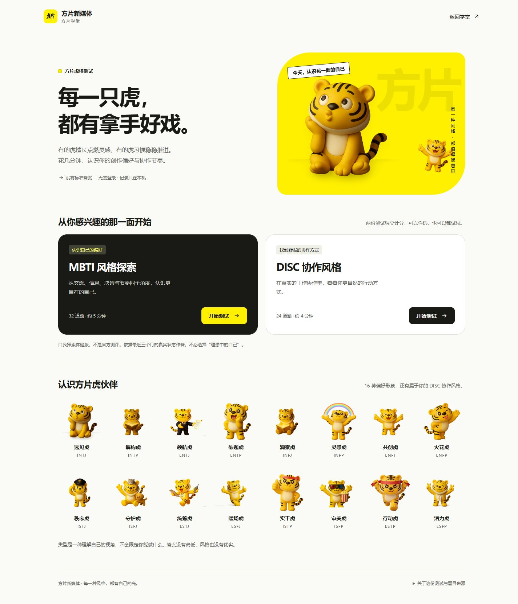
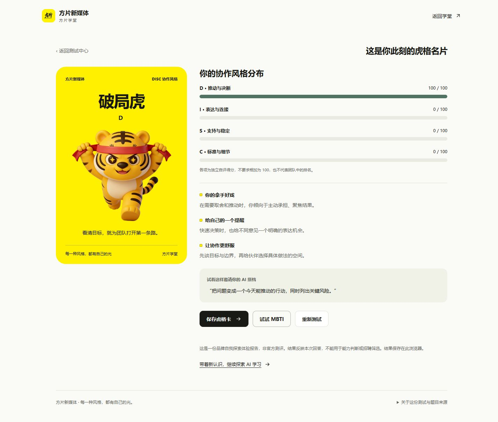

# 方片虎格测试开发说明

交付日期：2026-11-09。本次仅替换首页原大厂 JD 卡片位置，并新增独立的品牌测试模块；课程自测入口与学习进度保持各自用途。

## 页面与流程

- 五语言首页在原 JD 位置提供“你是哪种方片虎？”入口；英文、韩文入口注明测试为中文，避免误导。题目与报告目前仅支持中文。
- 测试中心可分别进入 MBTI 风格探索（32 题）与 DISC 协作风格（24 题）。
- 每题使用五档单选，回答后才开放下一步；支持返回修改、刷新续答与重测。
- 结果展示对应的方片虎、维度分布、创作优势、提醒、协作建议与 AI 共创提示，并可下载 1080×1440 PNG 虎格卡。
- 答案与结果只写入当前浏览器的 `fangpian_personality_v1`，独立于课程进度；无需账号、姓名，不发送到服务器。存储不可用时明确提示。

## 题目来源与适用边界

2026-11-09 已联网核对以下一手资料：

| 来源 | 用途 |
| --- | --- |
| [IPIP 公开题项与计分键](https://ipip.ori.org/newBigFive5broadKey.htm) | 参考主动交流、想象、关心他人、计划与秩序等题项主题，重新编写公司协作场景。 |
| [IPIP NEO 题项](https://ipip.ori.org/newNEOKey.htm) | 参考主导性、社交与日常行为主题。没有直接采用或宣称使用 NEO 原量表。 |
| [IPIP 授权说明](https://ipip.ori.org/newPermission.htm) | 官方声明材料处于公共领域，允许商业或非商业用途。 |
| [The Myers-Briggs Company：MBTI Facts](https://www.themyersbriggs.com/en-US/Support/MBTI-Facts) | 核对四对偏好与非招聘筛选用途。 |
| [Everything DiSC：模型说明](https://www.everythingdisc.com/what-is-disc/) | 核对 D、I、S、C 的含义，作为场景题编写参考；未使用其受保护的商业问卷或报告。 |

题目、中文转述、选项、反向项、计分和品牌角色解读均由本项目独立设计，不能沿用原量表的信度、效度或常模。特别是，IPIP 的大五主题不等于 MBTI 四维偏好，本项目没有进行经验证实的二者换算。本模块是 MBTI **风格**与 DISC **风格**的自我探索体验，不能称为官方量表或标准化心理测评。

常见 [OEJTS 1.2 问卷](https://openpsychometrics.org/tests/OJTS/development/OEJTS1.2.pdf) 标注 CC BY-NC-SA 4.0。考虑到公司平台用途，本次未复制或翻译该题库。参考定义不代表得到任何测评机构的认可或背书。

页面的“关于这份测试与题目来源”提供可点击来源与说明。MBTI®、Everything DiSC® 等名称的权利属于各自权利人。

## 独立计分方法

MBTI 风格题包含 E/I、S/N、T/F、J/P 四维，每维 8 题，四个正向与四个反向题交错出现。每题 1–5 档，围绕中点 3 计入 −2 至 +2 的贡献；按题目方向累计到对应维度。每维累积值 −16 至 +16，线性显示为 0–100% 的第一侧偏好，第二侧为其补数。该百分比只是本题集的相对回答倾向，**不是准确率、置信度或人口百分位**。

维度恰好持平时用 X 表示，部分持平如 XSTJ、全部持平 XXXX 均显示“多面虎”，不虚构确定的四字母类型。累积绝对值不超过 4 时提示倾向接近。

DISC 风格题每类 6 题，3 个正向与 3 个反向。正向按回答减 1、反向按 5 减回答得到 0–4 分；各维独立累加后除以 24，显示为 0–100 的自评分。最高得分确定主风格；最高分并列时展示并列字母与“多面虎”，前两项相差不超过 8 分时提示混合倾向。四维不要求相加为 100。

以上阈值均为产品规则，未作为心理学研究结论。

## 品牌与素材

仅使用用户素材库中已有的方片 Logo 与 3D 老虎 WebP。UI 以品牌黄 `#fff000`、黑色文字和浅色背景构成，动作、名片与角色文案为公司内容创作场景重新设计。新图标使用 SVG，非首屏老虎图延迟加载，避免加载外部字体或图库。

| 类型 | 老虎角色 | 素材 |
| --- | --- | --- |
| INTJ | 远见虎 | tiger-thinking-seated.webp |
| INTP | 解构虎 | tiger-reading-standing.webp |
| ENTJ | 领航虎 | tiger-suit-document.webp |
| ENTP | 破题虎 | tiger-star-eyes-excited.webp |
| INFJ | 洞察虎 | tiger-reading-seated.webp |
| INFP | 灵感虎 | tiger-holding-rainbow.webp |
| ENFJ | 共创虎 | tiger-open-arms.webp |
| ENFP | 火花虎 | tiger-wink-wave.webp |
| ISTJ | 秩序虎 | tiger-cap-salute.webp |
| ISFJ | 守护虎 | tiger-with-pets.webp |
| ESTJ | 统筹虎 | tiger-walkie-talkie.webp |
| ESFJ | 暖场虎 | tiger-double-thumbs-up.webp |
| ISTP | 实干虎 | tiger-headband-thumbs-up.webp |
| ISFP | 审美虎 | tiger-cinema-popcorn.webp |
| ESTP | 行动虎 | tiger-headband-running.webp |
| ESFP | 活力虎 | tiger-double-v.webp |
| D | 破局虎 | tiger-headband-running.webp |
| I | 表达虎 | tiger-open-arms.webp |
| S | 同行虎 | tiger-with-pets.webp |
| C | 精研虎 | tiger-teacher-pointer.webp |
| 持平/不明确 | 多面虎 | tiger-seated-smile.webp |

角色名称用于帮助理解偏好，无优劣排行，不推导岗位适配、工作能力或心理健康状况。

## 验证与维护

自动化测试覆盖 16 种类型映射、4 种 DISC 主风格、反向题、持平、漏答/非法数据、旧记录清洗以及首页和素材引用。`npm test` 同时运行既有学习进度测试与新测试。

浏览器验收使用预设样例作答，非用户或员工的真实结果：完整 32 题得到 ENTJ 领航虎、完整 24 题得到 D 破局虎；验证刷新续答、上一题修改、结果刷新恢复、PNG 下载及手机报告布局。验收后重置本次样例，入口保留空白测试状态。

浏览器布局检查覆盖 375、768、1440 宽度。资源/语法检查覆盖全量静态页面；没有把代表性交互抽查宣称为所有旧课件的完整回归。

交付检查：`npm test` 18 项全部通过；`verify:content` 检查 2,542 个 HTML、80 个 JS 与 2,248 段经典内联脚本，错误 0；`check:resources` 缺失引用 0；`check:cleanup` 目标广告/JD 残留 0；生产构建成功。新增页面浏览器抽查未捕获控制台错误。

维护时修改 `personality-data.js` 中的题目与映射；题数、计分或问卷结构变更须同步调整测试，并增加版本号，避免旧答卷套入新题。`scripts/integrate-personality.py` 是幂等的入口迁移工具，日常构建不执行。

