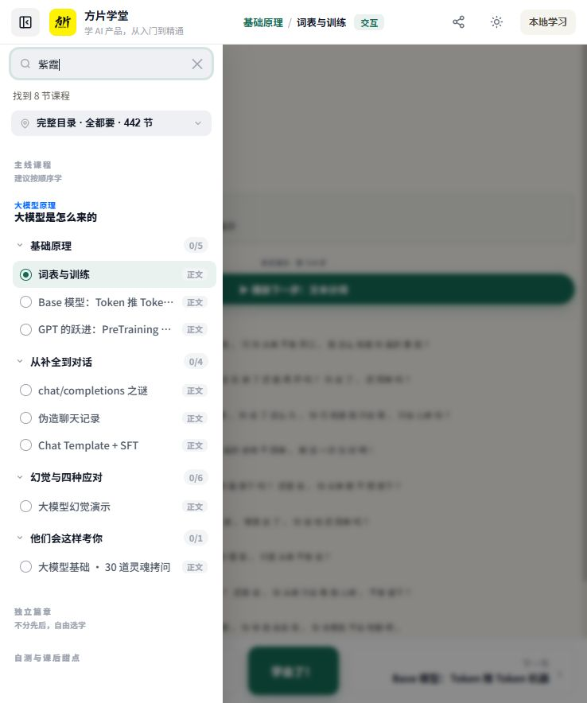

# 第二批交付：本地学习与可用性修复

交付日期：2026-11-09。承接第一批清理后的 FP-08/FP-09，先让现有课程在本地完整运行，为老虎品牌界面改造提供稳定基础。第一批交付记录为历史快照，当前功能状态以本文为准。

## 已完成

| 项目 | 结果 |
| --- | --- |
| 本地学习 | 五语言课程直接阅读，保留真实的未登录状态，移除旧登录遮罩和云服务调用。简中 442 节，英/韩各 399 节，繁台/繁港各 466 节。 |
| 学习进度 | 标记、撤销、刷新恢复、继续上次学习、同源标签页同步。兼容旧进度键与语言后缀，避免重复计数；切换语言不会删除该语言没有的课程进度。 |
| 存储失败 | 当前页可以继续学习，并明确提示记录可能无法保存。不会显示已经登录或已同步到公司账号。 |
| 本地搜索 | 标题即时匹配、正文按语言延迟加载；包含课件脚本生成的教学文字，支持多个关键词、加载提示、空状态和失败重试。旧请求结果不会覆盖新查询。 |
| 首页真实状态 | 展示实际完成数量与章节进度，恢复继续学习链接，隐藏无服务支撑的热门排序。 |
| 练习与自测 | 保留答题、解析、错题回顾与本机续刷；最近 50 次结果保存到本浏览器。修复自测中心的考试/刷题模式在阅读器跳转时丢失的问题，刷新后仍保留所选模式。 |
| 失效入口 | 移除旧广告、统计、账号后端的请求。证书、投稿/社区等未接入服务显示明确说明，关闭问题反馈入口及错误的个人中心说明。 |
| 缺失素材 | 移除缺失的旧练习/PWA等可选脚本引用。150 个爸妈版页面暂显示整理中，不冒充可用课程；10 个社区相关页面显示待接入。 |
| 多语言错误 | 修复原版 25 处英文/韩文脚本语法错误。语法检查改为任何错误均失败，历史问题列表保留供追溯。 |

## 验证记录

- 自动化测试 11 项：进度保存/撤销、旧数据兼容、跨语言保留、存储受限、非法数据、变更通知、成绩保留上限、搜索缓存/重试、五语言索引覆盖及考试模式路由。
- `npm run verify:content`：2,541 个 HTML、78 个 JS、2,248 段经典内联脚本；新增错误 0、原版残留错误 0，五语言目录与对应翻译文件均存在。
- `npm run check:cleanup`：目标推广、首页 JD 等清理检查剩余 0。
- `npm run check:resources`：HTML/CSS 静态本地素材引用缺失 0，报告在 `reports/local-resources.json`。此检查不代表所有外部参考链接均已在线验证。
- `npm run build`：生产构建成功；搜索索引随构建生成并进入静态输出。
- 浏览器验证：五语言首页与课程搜索；正文词“紫霞”命中 8 节课程；无结果提示与清空恢复；完成标记刷新恢复、撤销和另一标签页同步；练习正确判定/解析；自测中心两种模式与刷新保留。
- 响应式检查：375、768、1440 像素宽度的阅读器未发现横向溢出；本次抽查未捕获控制台错误。语法与资源检查覆盖全量，交互为代表性抽查。

## 维护方式

`public/slides/` 仍为唯一维护目录。新增 `local-learning.js`、`local-search.js`、`local-home.js` 承载本地功能；旧 auth/paywall/watermark 接口仅保留兼容用途，不连接原站。

`predev`、`prebuild`、`pretest` 自动生成五种语言的正文索引，生成物不进入 Git。更新课件后也可单独运行 `npm run build:search`。当前每个语言索引约 3.0–3.5 MiB，gzip 约 1.0–1.3 MiB；仅首次搜索加载当前语言，首页不预下载全部索引。完整离线缓存尚未实现。

`phase2-migration.py`、`finalize-local-release.py`、`polish-local-release.py` 保存本次迁移步骤，只用于追溯和基线迁移，不在日常构建中执行。历史原始素材快照不再回写。

## 下一阶段

下一批进入老虎品牌首页、课程阅读器、方片助教区域和课程封面的统一设计。随后制作一组公司场景课程样板，再逐页审校、补充音乐课程与真实员工评价。当前课件尚未全部完成原创改写，也未承诺查重通过。

公司账号、云端进度、证书、员工资料、ARP 地址和模型 API 需要对应服务/资料后再接入。API Key 不应写入公开前端源码。爸妈版需补齐原始素材后另行验收。

